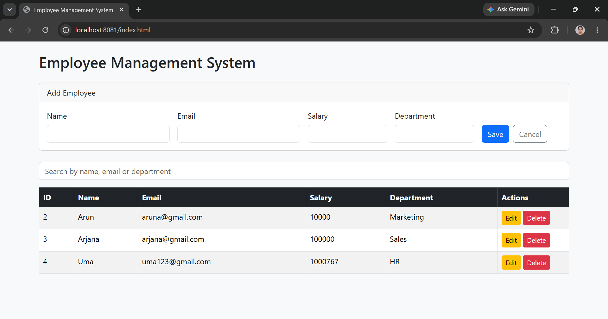
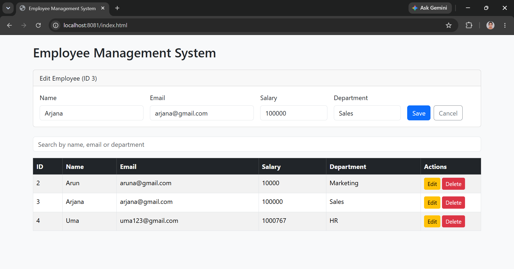

# Employee Management System

A web application to add, view, edit, delete and search employees.
Spring Boot REST API with a browser-based frontend.

## Features
- Add, edit, delete and list employees
- Search by name, email or department
- Role-based access: ADMIN can change data, USER can only view
- Input validation (name, valid email, positive salary, department)

## Tech Stack
Java 21, Spring Boot, Spring Data JPA / Hibernate, Spring Security (HTTP Basic),
MySQL, HTML, JavaScript (fetch API), Bootstrap 5

## Screenshots

## API Endpoints
| Method | URL | Description |
|---|---|---|
| GET | /employees | List all employees |
| GET | /employees/{id} | Get one employee |
| POST | /employees | Add an employee (include id to update) |
| DELETE | /employees/{id} | Delete an employee |

## How to Run
1. Install JDK 21 and MySQL
2. Clone this repo
3. In `src/main/resources/application.properties`, set your MySQL password
4. Run `EmsApplication.java`
5. Open http://localhost:8081/index.html
6. Log in with admin / admin123 (ADMIN) or user / user123 (USER)

## What I Built
Frontend (index.html): list, add, edit, delete and search, plus error handling.
